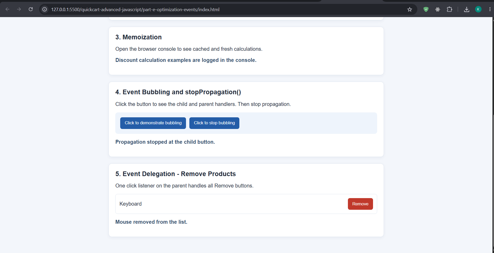

# QuickCart -- Advanced JavaScript Practical Assignment

## About the project

This project is based on the Advanced JavaScript Practical Assignment. I
worked on a small shopping-cart example called QuickCart and completed
the tasks in six parts. The work covers JavaScript objects and classes,
array methods, JSON, asynchronous programming, browser events and a
final order summary.

## Technologies used

-   JavaScript (ES6+)
-   HTML
-   CSS
-   Node.js
-   Visual Studio Code
-   Google Chrome
-   VS Code Live Server (for Part E)

No external JavaScript libraries or frameworks are used.

## Folder structure

``` text
quickcart-advanced-javascript/
│
├── part-a-objects-classes/
│   └── products.js
├── part-b-array-methods/
│   └── shopping-cart.js
├── part-c-json-debugging/
│   └── json-handling.js
├── part-d-asynchronous/
│   └── order-processing.js
├── part-e-optimization-events/
│   ├── index.html
│   ├── script.js
│   └── style.css
├── part-f-integration/
│   └── quickcart.js
├── screenshots/
│   ├── part-e-debounced-search-and-scroll.png
│   ├── part-e-event-bubbling-and-delegation.png
│   └── part-e-remove-products.png
├── QUESTIONS-ANSWERS.md
└── README.md
```

## Part A -- Objects, Prototypes and ES6 Classes

I created products using a constructor function and added a shared
method using `Product.prototype`. I also used ES6 classes and
inheritance to create electronic and clothing products.

Concepts practised: - Constructor functions and prototype methods -
`__proto__` and `prototype` - ES6 classes, `extends` and `super()` -
Arrow functions and template literals - Destructuring, rest and spread
operators

**Run in the terminal:**

``` bash
node ./part-a-objects-classes/products.js
```

## Part B -- Higher-Order Functions, Map, Set and Object Methods

I used a shopping cart array to calculate product totals and the full
cart value. I also created an inventory with `Map`, removed duplicate
email addresses using `Set`, and tested `Object.freeze()` and
`Object.seal()`.

Concepts practised: - `map()`, `filter()`, `reduce()` and `forEach()` -
Combining array methods - `Map` and `Set` - `Object.freeze()` and
`Object.seal()`

**Run in the terminal:**

``` bash
node ./part-b-array-methods/shopping-cart.js
```

## Part C -- JSON Handling and Output-Based Debugging

I converted an order object into a JSON string and parsed it back into a
JavaScript object. I also checked how JSON handles `undefined`,
functions, `null`, `NaN`, `Infinity`, invalid JSON, circular references
and dates.

Concepts practised: - `JSON.stringify()` and `JSON.parse()` - JSON value
conversion - Error handling while parsing or stringifying data

**Run in the terminal:**

``` bash
node ./part-c-json-debugging/json-handling.js
```

## Part D -- Asynchronous JavaScript

I practised the order-processing steps using callbacks, Promises and
async/await. I also used Promise combinators to see how multiple
asynchronous tasks behave when they succeed or fail.

Concepts practised: - Event loop, call stack, microtasks and
macrotasks - `setTimeout()` and callbacks - Promise chaining with
`.then()` and `.catch()` - `async`, `await` and `try...catch` -
`Promise.all()`, `Promise.allSettled()`, `Promise.race()` and
`Promise.any()`

**Run in the terminal:**

``` bash
node ./part-d-asynchronous/order-processing.js
```

## Part E -- Performance Optimization and DOM Events

This part runs in the browser. I created examples for debounced search,
throttled scrolling, memoization, event bubbling, stopping propagation
and event delegation to remove products from a list.

Concepts practised: - Debouncing with a 500 ms delay - Throttling with a
1000 ms interval - Memoization and caching - Event bubbling and
`stopPropagation()` - Event delegation

**How to run:**

1.  Open the project folder in VS Code.
2.  Open `part-e-optimization-events/index.html`.
3.  Right-click the file and select **Open with Live Server**.
4.  Try the search box, scroll the page and click the event buttons.
5.  Open Chrome Developer Tools with `F12` and check the Console for the
    memoization messages.

### Part E screenshots

**Debounced search and throttled scroll**


**Event bubbling and product removal**


**Remove products using event delegation**



## Part F -- Final Integration Challenge

In the final part, I combined the concepts from the earlier parts to
prepare an order summary for customer Rahul. The program uses product
data, calculates totals, tracks unique product IDs and inventory,
converts the order to JSON, and confirms the order asynchronously.

Concepts used: - `Product` class and destructuring - `map()`, `filter()`
and `reduce()` - `Set` and `Map` - `Object.freeze()` -
`JSON.stringify()` - async/await with `try...catch` - Template literals

**Run in the terminal:**

``` bash
node ./part-f-integration/quickcart.js
```

## How to run the project

First, make sure Node.js is installed. Check it with:

``` bash
node --version
```

Open the `quickcart-advanced-javascript` folder in VS Code. Run Parts A,
B, C, D and F using their commands above. Part E is a browser page, so
run it using Live Server.

The conceptual questions from the assignment are included in
**[QUESTIONS-ANSWERS.md](QUESTIONS-ANSWERS.md)**.

## Submission

-   GitHub repository: Add your public repository URL after publishing
    the project.
-   Loom recording: Add your Loom link after recording the project
    walkthrough. If a live link is not required, the assignment allows
    `N.A` in its place.
